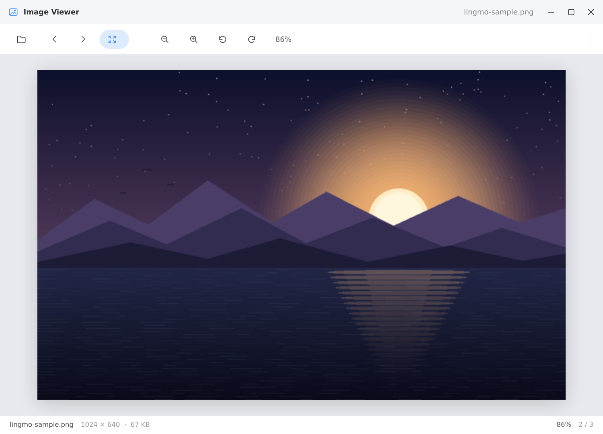
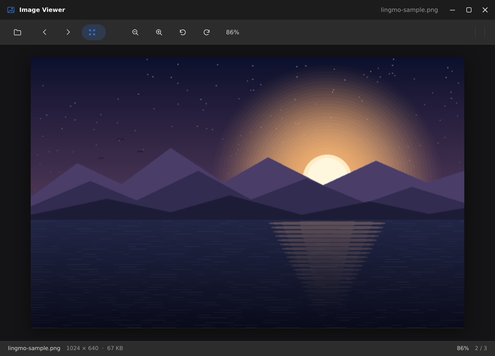

# lingmo-image-viewer

A small, fast image viewer for Lingmo OS, written with the native Lingmo SDK.

## Features

- Open pictures from the command line or the file chooser.
- Fit to window, actual size, zoom and rotate.
- Step through the other pictures in the same folder.
- Light and dark themes.

## Build

```sh
cmake -S . -B build -DCMAKE_PREFIX_PATH=/path/to/lingmo-sdk
cmake --build build
sudo cmake --install build
```

## Screenshots



